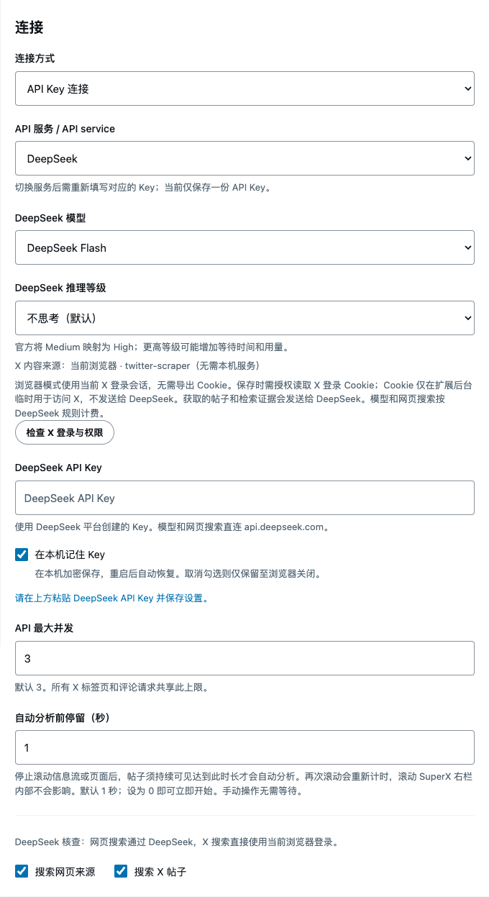

# 扩展内 X 搜索：twitter-scraper

此模式直接在 SuperX 扩展后台运行 JavaScript，不需要启动 Python、Node.js 或 Twikit 本机服务。使用 `@the-convocation/twitter-scraper@0.22.3` 的浏览器构建，模型生成和网页搜索仍使用 DeepSeek。

## 使用

1. 在当前 Chrome / Edge 中登录 `https://x.com`。
2. 在 `chrome://extensions` / `edge://extensions` 中加载或重新加载本项目的 `extension/` 目录，刷新已打开的 X 页面。
3. 打开 SuperX 设置，选择「API Key 连接」入口，将「API 服务」设为 **DeepSeek**，填写 DeepSeek Key。
4. X 内容固定使用 **当前浏览器 · twitter-scraper**，扩展不再提供 Twikit 服务选项。
5. 点击「检查 X 登录与权限」，允许读取 X 登录 Cookie 和访问相关 X 接口／静态资源。检查只确认会话 Cookie 是否存在，不发送 DeepSeek 请求，也不表示真实搜索已经通过。
6. 启用 X 搜索和／或网页搜索，保存设置、启用 SuperX，再回到 X 查看核查结果。网页搜索使用 DeepSeek Search，X 内容直接在扩展内获取。

DeepSeek 推理等级提供不思考（默认）、Low、Medium、High、Max。按官方规则，Medium 实际映射为 High；更高等级会增加输出预算，可能增加等待时间和用量。工具调用间会保留接口要求的推理上下文，但不会把推理文本显示在核查正文或存入历史。

只用 DeepSeek 网页搜索、不启用 X 搜索时，无需授予 Cookie 权限。扩展无需填写本机服务端口。模型和网页搜索仍可能产生 DeepSeek 费用。

## 支持范围



- 按 URL 读取原帖；使用库解析的正文（包括可获取的长文）。
- 返回已获取的直接上级和引用帖；接口只给出 ID 时，再补取这两条帖子。
- 搜索最新帖子，使用 X 搜索查询语法。每次工具搜索默认最多 5 条，适配层上限 20 条。
- 回复、引用相关内容可通过搜索与已知帖子的关联 ID 继续获取；没有“取全所有回复／引用”的保证。
- 直接上级或引用取不到时，返回明确的缺失 ID，不能把结果当成完整线程。
- 只返回文本、作者、链接和关联 ID，不声称检查图片或视频，不支持发帖、点赞、回复、私信等写入操作。

## 登录和数据

扩展申请可选 `cookies` 权限，只读取 `x.com` 的 `auth_token` 和 `ct0`。值仅在扩展后台的当前读取操作内存中使用，不写入扩展存储，不传给页面脚本、DeepSeek 或本机服务。真正的 Cookie 请求头由浏览器发送；适配层删除库生成的 Cookie、Origin、User-Agent 等浏览器保留请求头。

取回的帖子文字、作者和来源链接会作为核查证据发给 DeepSeek。X 登录发生变化时，取消相关任务并清理旧答案缓存／历史结果，防止复用上一个账号的答案。

请求仅限指定的 X 读取／搜索接口和签名所需的 X 静态资源。静态资源只作为文本解析，不执行下载的 JavaScript，不携带 Cookie 或认证头。搜索使用的 GraphQL POST 是查询，不是发帖。用户撤销相关权限后，正在进行的浏览器 X 核查会取消。

## 构建与测试

`extension/` 已包含构建产物，普通加载使用无需 `npm install`。更新依赖或修改打包配置时运行：

```sh
npm ci
npm run build:twitter
npm run check
```

打包脚本固定使用浏览器入口、原生 WebCrypto／JSON，禁用密码自动登录所需的 Node VM 路径，并将签名资源下载接到同一个受限、可取消的请求函数。另有 CSSOM 错误构造的无 eval 兼容修补。第三方许可完整附在 `extension/twitter-scraper-LICENSE.txt`。

测试覆盖真实浏览器构建在无 Node、禁止 eval 的 worker 环境中运行，GraphQL 读取／搜索解析、请求签名生成、父帖／引用补取、权限与 Cookie 缺失、请求范围、取消和错误脱敏。签名测试使用合成 HTML 和响应；**尚未在真实登录账号下验证 X 搜索，也未证明 X 当前接口对你的账号可用**。X 的非官方接口、查询 ID 或认证规则变更可能导致失败。

参考：[上游项目](https://github.com/the-convocation/twitter-scraper)、[浏览器用法](https://github.com/the-convocation/twitter-scraper#browser-usage)。
